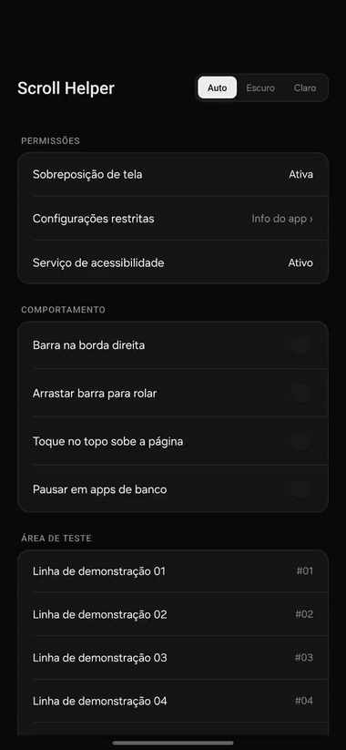

# Scroll Helper

iOS-style right-edge scrollbar and status-bar tap-to-scroll-to-top for Android 10+ (`minSdkVersion 29`, `~26 KB`, zero dependencies).

Works on any Android phone (Samsung One UI, Pixel, Xiaomi, Motorola, Nothing). Tested at 120Hz on a Galaxy S25 running Android 17 / One UI 9.



## Features

- Renders a 120Hz right-edge scrollbar in apps that hide the native indicator, including X (Twitter) and Jetpack Compose feeds.
- Skips `WebView`, standard `ScrollView`, and browsers that already draw their own scrollbar, plus provides a 1-tap toggle to disable the scrollbar for the most recently used app.
- Expands the scrollbar pill on long-press with haptic feedback so you can drag it vertically to scrub through long lists.
- Scrolls back to the top of any feed or browser when you tap the center of the status bar (camera cutout), while keeping swipe-down for notifications.
- Supports Auto, Dark, and Light themes and pauses automatically inside banking apps.

## Installation

### On device (direct APK or Obtainium)

1. Download `scroll-helper.apk` from [Releases](https://github.com/pedrosatin/android-ios-scroll/releases/latest) or add `https://github.com/pedrosatin/android-ios-scroll` to Obtainium.
2. Open **Scroll Helper** and grant **Display over other apps**.
3. On Android 13+, tap **Allow restricted settings**, open the top-right `⋮` menu on the App Info screen, and select **Allow restricted settings**.
4. Tap **Accessibility service** and enable **Scroll Helper**.

### Via ADB (recommended if you use banking apps)

Installing with `-i com.android.vending` sets Google Play Store as the installer source so banking apps do not flag the accessibility service as sideloaded:

```bash
curl -sL https://github.com/pedrosatin/android-ios-scroll/releases/latest/download/scroll-helper.apk -o scroll-helper.apk && \
adb install -r -g -i com.android.vending scroll-helper.apk && \
adb shell appops set dev.satin.scrollhelper SYSTEM_ALERT_WINDOW allow && \
EXISTING_A11Y=$(adb shell settings get secure enabled_accessibility_services | tr -d '\r') && \
if [ "$EXISTING_A11Y" = "null" ] || [ -z "$EXISTING_A11Y" ]; then \
  adb shell settings put secure enabled_accessibility_services "dev.satin.scrollhelper/dev.satin.scrollhelper.ScrollAccessibilityService"; \
else \
  adb shell settings put secure enabled_accessibility_services "${EXISTING_A11Y}:dev.satin.scrollhelper/dev.satin.scrollhelper.ScrollAccessibilityService"; \
fi && \
adb shell settings put secure accessibility_enabled 1
```

## How it fixes Jetpack Compose scrollbars

Jetpack Compose lazy lists (such as the X/Twitter timeline) emit `TYPE_VIEW_SCROLLED` with `fromIndex = -1`, `itemCount = -1`, and a synthetic `maxScrollY` fixed at `scrollY + 100`. Dividing `scrollY / maxScrollY` pins standard scrollbar overlays at 99%.

[`ScrollAccessibilityService.java`](src/dev/satin/scrollhelper/ScrollAccessibilityService.java) detects that constant `50..250 px` gap, tracks the highest `scrollY` seen in the session, and interpolates thumb position inside `Choreographer.FrameCallback` using exponential decay. When dragging the thumb, finger velocity is converted into continuous `GestureDescription` strokes instead of discrete `ACTION_SCROLL_FORWARD` page jumps.

## Build from source

```bash
./build.sh
```

## License

[MIT](LICENSE)
